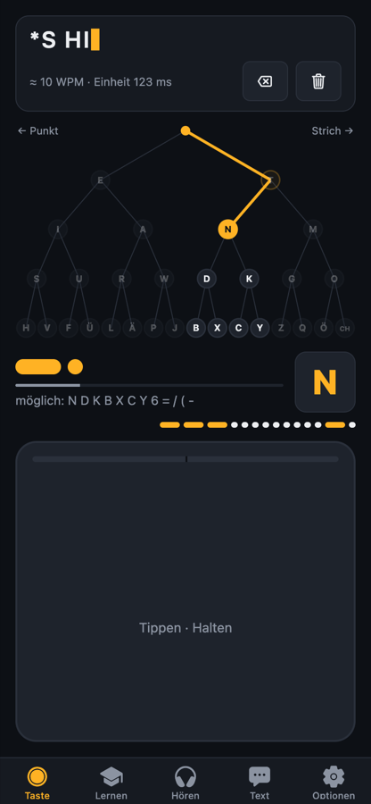
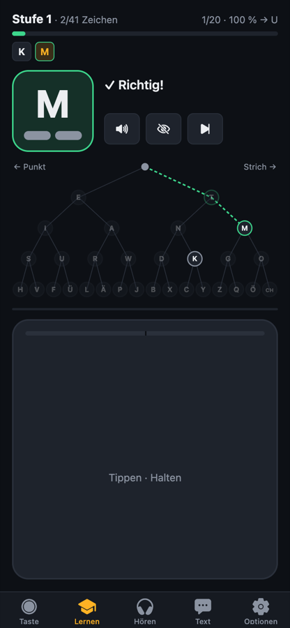
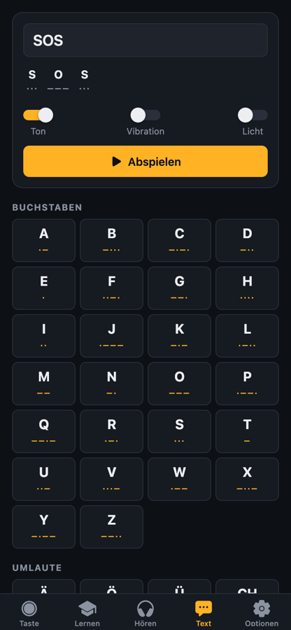

# Morse-Trainer

Handy-App zum Morsecode-Lernen: visualisiert nach jedem Druck Punkt/Strich und das aktuelle Wort.
Umsetzung des [Konzepts](concept.md) mit Expo (React Native, TypeScript).

<p>
  
  
  
</p>

## Funktionen

| Tab | Inhalt |
|---|---|
| **Taste** | Große Morsetaste mit Live-Dekodierung. Morse-Baum, in dem der aktuelle Pfad leuchtet und die noch möglichen Zeichen hell bleiben. Anzeige der Punkte und Striche, Pausenbalken bis zum Buchstabenende, Signalstreifen und geschätztes Tempo (WPM). |
| **Lernen** | Koch-Methode beim **Senden**: Die App zeigt ein Zeichen, du tastest es. Du startest mit K und M, ab 90 % Treffern über die letzten 20 Versuche kommt ein neues Zeichen dazu. Optional mit Hilfe (Code und Pfad im Baum). |
| **Hören** | Koch-Methode beim **Hören**: Ein Zeichen wird mit Farnsworth-Timing vorgespielt, du tippst die Antwort. Der Fortschritt wird getrennt vom Senden geführt. |
| **Text** | Text wird in Morse umgewandelt und als Ton, Vibration oder Lichtsignal (Bildschirm blinkt) ausgegeben. Dazu die Morsetabelle; ein Tipp auf ein Zeichen spielt es vor. |
| **Optionen** | Starttempo, automatische Tempo-Anpassung, Pausen-Toleranz, Zeichentempo und effektives Tempo (Farnsworth), Tonhöhe, Lautstärke, Haptik, Lernstufe. |

Ton (Sinus, Standard 650 Hz) und Haptik laufen bei jedem Druck mit. Im Browser dient die **Leertaste** als Morsetaste.
Einstellungen und Lernfortschritt werden lokal gespeichert (AsyncStorage). Ein Backend gibt es nicht.

## Starten

```bash
npm install
npx expo start        # QR-Code mit Expo Go (iOS/Android) scannen
npx expo start --web  # im Browser
```

Alle verwendeten Module sind in Expo Go enthalten, ein eigener Development-Build ist nicht nötig.

```bash
npm test              # Unit-Tests der Logik (Jest)
npm run typecheck
npm run lint
```

## Aufs iPhone bringen

Siehe **[DEPLOY.md](DEPLOY.md)**: kostenlos per Kabel über Xcode (7 Tage gültig) oder dauerhaft über
EAS Build + TestFlight. Texte für den App Store stehen in [store/app-store.md](store/app-store.md),
die Datenschutzerklärung in [PRIVACY.md](PRIVACY.md).

| Befehl | Zweck |
|---|---|
| `npm run check` | Typecheck, Lint, Tests |
| `npm run ios:sim` | Release-Build im iOS-Simulator |
| `npm run ios:device` | Release-Build per Kabel aufs iPhone |
| `npm run build:ios` / `npm run submit:ios` | Cloud-Build (EAS) und Upload zu TestFlight |

## Aufbau

```
src/
  app/                 Screens (Expo Router, Tabs)
  lib/                 reine Logik, vollständig getestet
    morse.ts           Tabelle, Kodierung, Morse-Baum, Kandidaten
    decoder.ts         Live-Dekodierung aus Druck- und Pausenzeiten
    timing.ts          PARIS-Timing, Farnsworth, Ton/Pause-Folgen
    koch.ts            Koch-Methode: Stufen, Freischalten, Zeichenauswahl
    wav.ts             Sinus-WAV-Synthese für iOS/Android
  audio/               Ton (nativ: expo-audio + WAV, Web: Web-Audio-API), Haptik, Wiedergabe
  hooks/useKeyer.ts    verbindet Decoder, Taste, Ton und Anzeige
  components/          Taste, Morse-Baum, Code-Anzeige, UI-Bausteine
  state/store.tsx      Einstellungen und Fortschritt (persistiert)
```

### Timing-Erkennung

- Punkt und Strich werden über getrennte Mittelwerte der Druckdauern unterschieden, die Schwelle liegt in der Mitte. Die Erkennung passt sich damit an Tempo **und** persönliches Punkt/Strich-Verhältnis an.
- Enthalten die letzten 16 Drücke zwei klar getrennte Längen (Verhältnis ≥ 2), werden beide Mittelwerte per 2-Means-Clustering bestimmt. So rastet die Erkennung auch dann nach wenigen Zeichen ein, wenn das eingestellte Starttempo weit daneben liegt.
- Pausen ab 2,5 Einheiten beenden einen Buchstaben, ab 5 Einheiten ein Wort (bei Pausen-Toleranz 1×). Das liegt jeweils zwischen den Standardwerten 1/3 bzw. 3/7, sodass korrekt getastete Pausen sicher erkannt werden. Mit der Pausen-Toleranz lassen sich beide Schwellen strecken.
- Standard: Starttempo 20 WPM (60 ms pro Einheit, Strich ab 120 ms Halten), Pausen-Toleranz 1×. Wer innerhalb von Buchstaben länger zögert, erhöht die Pausen-Toleranz in den Optionen.

## Grenzen / offene Punkte

- Auf echten Geräten noch nicht getestet. Geprüft sind die Unit-Tests, der Web-Build per Browser-Automatisierung und das Bundling für iOS/Android.
- Nativ wird der Mithörton als geloopte WAV-Datei abgespielt. Die Latenz beim Drücken hängt vom Gerät ab; falls sie stört, wäre ein natives Audio-Modul (z. B. react-native-audio-api) der nächste Schritt.
- iOS kann nicht beliebig lange vibrieren. Die Vibrationsausgabe wird dort durch schnelle Haptik-Impulse angenähert.
- Noch nicht umgesetzt aus dem Konzept: echte Taschenlampe (statt Bildschirm-Blitz), Morse-Chat zwischen zwei Handys, Wort- und Gruppenübungen beim Hören.
